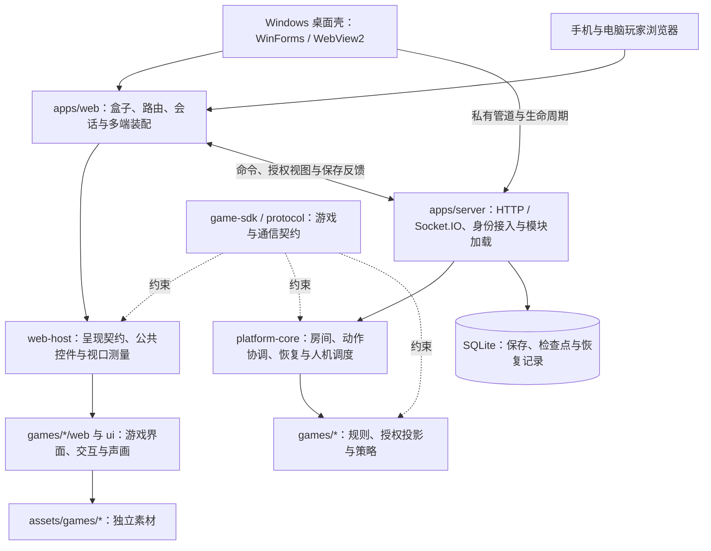

> 2026-10-30归档。保留实施前A01—A09建议；实际落地与余项见[实施状态](../reference/architecture-improvements.md)。 原文件：`docs/reference/architecture-improvements.md`，归档前UTF-8 SHA-256：`cc0baf3d5b6120fdfdf8915cdf11cd3e276ffbfd52f5308072c0299f54a779eb`。修正搬迁后的相对链接并采用项目格式化，历史结论与未验范围保持。

# 架构优化建议

2026-10-30，依据当前源码的只读抽查整理。本文保存优化判断、优先级及实施边界，属于待评估方案，不代表已实施、已验收或获准启动全部改造。主线程正在进行的宝可梦扩展整改可能改变局部实现，实施前须重新核对相关源码。

当前架构事实以[代码与进程边界](../reference/architecture.md)为准；公共界面的既有能力与候选接口以[界面复用](../reference/ui-composition.md)为准。本文不另立 SDK、通信、存档或权限契约。

## 判断与架构示意

现有“模块化单体＋独立游戏模块＋多端呈现”适合一台电脑开桌、多设备加入的定位。优先整理游戏表现层与大型协调模块，不需要推倒重建，也没有足够证据支持引入微服务、第二套 UI 框架或统一所有游戏的布局引擎。

箭头表示调用、数据或契约关系，不表示每个方框都是独立进程。游戏可独立构建，最终仍组装为唯一完整 EXE。

应继续保留的边界：服务端权威、按身份投影秘密、游戏模块内聚、旧局绑定原发行、声画跟随已保存结果。优化不能绕过统一动作校验、保存事务及恢复不补播约束。

## 优化清单

| 编号 | 优先级 | 观察与依据                                                         | 建议                                                                             | 完成判断                                                           |
| ---- | ------ | ------------------------------------------------------------------ | -------------------------------------------------------------------------------- | ------------------------------------------------------------------ |
| A01  | 高     | 宝可梦扩展网页入口约1951行，聚合多种阶段、角色和交互               | 提取阶段控制器、授权视图模型、牌桌组件与决策组件；入口只装配                     | 单阶段修改有明确文件边界；既有合法动作、秘密投影与选择状态保持     |
| A02  | 高     | 扩展 layout.css 约1965行，legacy.css 另引入六层历史主题样式        | 明确组件与端的样式所有权，逐步合并被覆盖规则，保留单一布局规则来源               | 横竖屏、管理与玩家的定向截图通过；不依赖继续叠加覆盖来修复         |
| A03  | 高     | 已有 PlayerDecisionLayout 父抽象与横竖屏实现，主要区别仍为容器结构 | 同一决策契约下提供手机、电脑各自的决策内容实现；共享状态、校验与提交             | 两端内容密度与操作组织适配各自需求；旋转后草稿保持、确认只提交一次 |
| A04  | 高     | 保存事件已与表现分离，但角色演出时长仍关联旧关节动作元数据         | 分离保存事件解释、演出描述与渲染器；统一时间轴和取消机制，镜头与角色特征留在游戏 | 更换演出不改规则；取消、恢复、减少动态与连续演出取样通过           |
| A05  | 中     | RoomCoordinator 约1919行，协调职责集中                             | 围绕动作事务、授权、恢复与投影逐步提取内部服务，保留唯一提交与保存边界           | 不产生第二套状态权威或提交路径；保存失败、回退与授权回归通过       |
| A06  | 中     | SDK、协议、宿主与游戏已经有明确依赖方向                            | 补足自动依赖约束，禁止共享层导入游戏、游戏读取私有会话或相互导入                 | 新增越界依赖能由现有检查入口明确拒绝；合法兼容适配有说明           |
| A07  | 中     | 多端、阶段、权限与演出形成大量验证组合                             | 在现有验证器中统一场景维度并复用合法局面，补充连续动画、取消／恢复及秘密泄漏断言 | 测试输入与证据可追溯；不另建用例账本，不以静态截图代替动态证明     |
| A08  | 中     | 素材已有外部准备区、正式区与来源记录                               | 在构建阶段核对实际引用、运行白名单、尺寸预算及来源，明确原件与运行派生物         | 未引用大图不进入运行包；资源来源及包体增量可核查                   |
| A09  | 低     | 架构正文包含现状、迁移记录与安装细节                               | 保留精简现状图和职责表，详细过程链接到所属主题                                   | 能按问题快速到达唯一正文，旧锚点可用，避免多份全文漂移             |

行数仅为2026-10-30抽查时的定位线索，不是质量指标，也不作为拆分验收门槛。A06—A08须先检查已有自动化覆盖，只补缺口。

## 建议实施顺序

1. 先在宝可梦扩展内部落实 A01—A04，每次只改变一类职责，以实际画面和操作体验判断收益。
2. 两个以上真实消费者证明共性后，再把小能力提升到 web-host。游戏阶段、牌阵拓扑、主题和能力解释继续留在游戏内。
3. A05 单独安排平台范围任务；不与视觉整改混合，避免扩大保存、授权和旧局恢复风险。
4. A06—A08按已有工具缺口渐进补齐；A09随主题更新整理，不进行无差别批量搬迁。

尤其对 A03：继承同一父抽象只是结构起点。手机可采用紧凑纵向流程，电脑可采用持续可见的场地与决策区；如果内部仍原样复用所有内容，就可能只是把手机组件放进更宽的容器。应共享决策含义和行为，让不同端拥有合适的呈现实现。

## 抽查入口与验证边界

- [服务装配](../../apps/server/src/service.ts)、[房间协调](../../packages/platform-core/src/room.ts)：运行接入与核心协调职责。
- [游戏契约](../../packages/game-sdk/src/index.ts)、[客户端加载](../../apps/web/src/game-clients/registry.ts)：授权视图、模块与发行加载。
- [玩家布局抽象](../../games/pokemon-encounters/ui/PlayerDecisionLayout.tsx)：既有横竖屏实现。
- [扩展入口](../../games/pokemon-encounters/expansion/web/index.tsx)、[布局样式](../../games/pokemon-encounters/expansion/web/layout.css)、[历史样式组合](../../games/pokemon-encounters/expansion/web/legacy.css)：组件与样式整理范围。
- [架构现状](../reference/architecture.md)、[界面复用](../reference/ui-composition.md)：当前边界和已有优化计划；重叠建议复用原计划，不建立平行实现。

本次仅进行了目录、文档及代表性源码抽查，没有完成全库依赖审计、性能测量或安装验收。本文落盘不改变代码、公开 API、协议、存档、版本或发布状态。后续实施按[范围验证](../reference/validation.md)选择检查，并保留主线程与其他任务的工作区改动。
