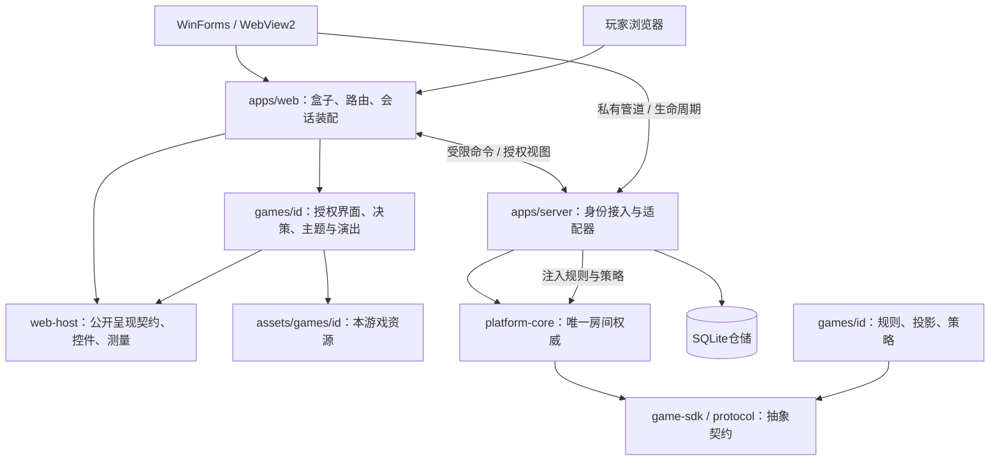

# 代码结构与工程边界

2026-10-30现行源码。产品为管理兼展示与玩家两类入口；服务端权威、按身份投影秘密、游戏独立构建、旧局绑定原发行。此次内部拆分不新增公共API、协议或存档字段，不调整版本、安装器或冻结发行。实施状态见[架构优化](architecture-improvements.md)，历史说明见[整理前原文](../archive/architecture-before-optimization-20261030.md)。

## 当前职责与依赖

箭头表示调用、输入或依赖，不表示独立进程。应用加载器装配具体游戏；共享包不反向导入游戏。

| 位置                                      | 所有权与边界                                                                              |
| ----------------------------------------- | ----------------------------------------------------------------------------------------- |
| apps/desktop/native、installation-runtime | net48原生窗口、管理凭证私有管道、桥接及安装事务；不实现规则和数据库                       |
| apps/server                               | HTTP／Socket.IO、SQLite、模块仓库、Worker适配；将依赖注入核心                             |
| apps/web                                  | 盒子、身份会话、路由、设备与显示策略、玩家iframe；游戏拿不到完整RoomSession／凭证／Socket |
| packages/game-sdk、protocol               | 类型、动作、投影和信封契约；不依赖应用或具体游戏                                          |
| packages/platform-core                    | 房间状态、统一动作、授权、保存协调、恢复与人机调度；不依赖SQLite、Socket.IO或具体游戏     |
| packages/web-host                         | GameHost／GameClient、公共控件、偏好及纯视口测量；平台专用入口不开放给游戏                |
| games/id、assets/games/id                 | 规则、秘密投影、策略、交互、布局、演出与资源内聚；禁止跨游戏私有依赖                      |
| tools/build、tools/test                   | 目录发现、独立构建、受影响范围验证与证据；不进入运行规则                                  |

## 房间状态与提交

[RoomCoordinator](../../packages/platform-core/src/room.ts)仍拥有唯一Save及commit／execute路径，动作进入串行队列后重新核验当前身份、决策及发行；提交成功才广播和演出。保存失败不得发布未保存结果；checkpoint、换机授权与恢复分支不是同一概念。随机源、规则和人机意图继续走既有契约。

内部职责拆分为[RoomOperations](../../packages/platform-core/src/room-operations.ts)（串行、关闭屏障和保存失败标记）、[room-projection](../../packages/platform-core/src/room-projection.ts)（无状态授权视图组合）及[save-draft](../../packages/platform-core/src/save-draft.ts)（原有草稿复制）。前两者分别只接收操作回调或投影上下文，没有第二个仓储／commit入口。管理员只获公开游戏投影，玩家只获本人授权投影；投影调用保留克隆边界。

存档仍为普通JSON数据，不保存函数、定时器、连接或Promise。SQLite去重、迁移和持久事务由仓储维护，准确权限与恢复语义统一见[平台规格](phase-02-platform-spec.md)；策略、取消和Worker隔离归[人机规格](bot-players.md)。

## 游戏呈现的当前分层

宝可梦扩展作为本轮落点：`web/index.tsx`仅装配；`view-model.tsx`解释授权数据；`useDecisionController.ts`独占选择草稿和合法提交；Cards／PublicSupply／Rulebook／ScreenBody／DecisionContext／DecisionField／DecisionFooter分别组合内容。规则与投影没有迁入React层。

`DecisionContent`父抽象下的手机与电脑实现决定信息密度：手机保留紧凑卡面与操作，电脑增加阶段抬头、牌源说明与研究图。两端共用控制器，旋转不重建草稿，不复制确认逻辑；外框仍用既有PlayerDecisionLayout。它们只属于宝可梦，未升级为所有游戏必须采用的布局框架，原则见[界面复用](ui-composition.md)。

保存反馈经playback解释，再由纯`PresentationClock`管理队列、计时、消费与取消；`presentation-anchors`读取实际授权DOM；React Context订阅并清理；`entrance-descriptors`仅提供演出时长／范围，SavedEffects消费描述和当前漫画切入渲染。运行播放不再依赖旧关节姿态元数据。实例／分支／角色组成授权连续性键，变化时消费已有反馈并取消旧计时；同一授权下正常进入下一小局，仍可播放该次新保存反馈。秘密卡面不得为动画补入公共DOM，减少动态继续走静态替代。

样式所有权按用途划分：`theme.css`承接六份历史主题的原顺序；`layout.css`只按序装配牌桌、决策流、视口及工作台四段；`arena.css`保持当前主题。此次仅删除已证明完全重复的一条规则，其余覆盖不能仅凭静态搜索判死后删除。

## 可执行的依赖与资源边界

[dependency-boundaries](../../tools/build/dependency-boundaries.mjs)同时被ESLint和独立构建消费，覆盖静态导入、导出、动态导入及私有路径。共享包不得读取games／游戏assets／apps；游戏只能依赖本游戏和已允许的公开契约。测试的Node夹具有精确位置例外，生产构建不接受该例外，防止测试便利进入运行载荷。

游戏由`game-module.json`发现，不增加中心注册表；规则、策略、网页与资源继续独立构建。React／宿主共享运行时保持既有固定本地ESM路径和旧ABI；版本、冻结及缓存机制见[开发说明](development.md)与[Release](release.md)。

资源先按实际源码引用发现，再检查已有来源manifest中的可选`runtimePolicy`。当前漫画资源组启用：白名单、SHA、实际字节、PNG／WebP尺寸及单图／总量预算。清单与检查器纳入构建指纹，来源JSON不复制进运行包；未引用素材不因登记而自动打包。尺寸头检查不等于完整解码，源素材授权与审美核验仍归[素材方法](../games/pokemon-encounters/assets.md)。其他资源组尚未自动补齐来源预算，后续按实际缺口接入。

## 运行、交付与验证

管理路由`/host`、`/host/game`要求真实管理员；`/`、`/player`及`/player/game`为玩家；旧`/public`路由返回410及玩家入口，不授予管理权限。原生只通过可信顶层桥接和私有管道持有管理能力，Job Object负责服务后代生命周期。当前共性见[平台规格](phase-02-platform-spec.md)，窗口和DPI见[盒子视觉](box-visual-design.md)。

Windows仅交付完整installer EXE，C# WinForms／.NET Framework4.8、共享WebView2和包内Node22.14.0。历史模块只用于精确原局恢复，新局使用当前完整EXE核验映射；签名、安装身份、更新屏障、字节上限和旧发行保护归[构建与运行](build-and-run.md)及[Release](release.md)，本页不复制第二份流程。

本轮适用证明包括权限／保存／关闭／恢复单测、构建约束反例、源码浏览器合法局面及连续演出。结果和历史失败见[实施记录](../archive/architecture-optimization-20261030.md)。性能收益尚未实测；源码验证不替代真实设备、网络持久化或完整安装器验收。检查选择与失败预算归[验证](validation.md)。

## 面向对象与适度封装

生命周期与不变量用对象，规则／计分／投影用纯函数，React保留函数组件。共享能力须由实际消费者证明共性；游戏知识不提升到共享枚举、全局状态容器或通用DSL。优化以所有权清楚、行为可核验为准，不能以文件变短或新增类数证明收益。

## 历史章节入口

以下原锚点继续可达。旧安装过程、发行参数与迁移判断保留在快照，现行职责以上文和对应唯一主题为准。

[唯一完整 EXE 交付（2026-10-12）](../archive/architecture-before-optimization-20261030.md#唯一完整-exe-交付2026-10-12)。

[安装身份与整个程序更新](../archive/architecture-before-optimization-20261030.md#安装身份与整个程序更新)。

[安装执行与证据模块](../archive/architecture-before-optimization-20261030.md#安装执行与证据模块)。

[安装执行与证据模块（接口待验证）](../archive/architecture-before-optimization-20261030.md#安装执行与证据模块接口待验证)。

[宝可梦原版适配与稳定复用边界（2026-10-05）](../archive/architecture-before-optimization-20261030.md#宝可梦原版适配与稳定复用边界2026-10-05)。

[SQLite去重存储（2026-10-06）](../archive/architecture-before-optimization-20261030.md#sqlite去重存储2026-10-06)。

[已建立的工程](../archive/architecture-before-optimization-20261030.md#已建立的工程)。

[独立构建与模块边界](../archive/architecture-before-optimization-20261030.md#独立构建与模块边界)。

[面向本轮适配的架构优化计划](../archive/architecture-before-optimization-20261030.md#面向本轮适配的架构优化计划)。

[兼容迁移与可回退单元](../archive/architecture-before-optimization-20261030.md#兼容迁移与可回退单元)。

[架构改进的可核验收益](../archive/architecture-before-optimization-20261030.md#架构改进的可核验收益)。

[运行与入口](../archive/architecture-before-optimization-20261030.md#运行与入口)。

[游戏目录与授权（1.6.0）](../archive/architecture-before-optimization-20261030.md#游戏目录与授权160)。

[动作、随机与恢复](../archive/architecture-before-optimization-20261030.md#动作随机与恢复)。

[独立原型与验证分层](../archive/architecture-before-optimization-20261030.md#独立原型与验证分层)。

[资源与保存结果表现](../archive/architecture-before-optimization-20261030.md#资源与保存结果表现)。

[电脑显示控制](../archive/architecture-before-optimization-20261030.md#电脑显示控制)。

[独立发行与公共契约（2026-10-11）](../archive/architecture-before-optimization-20261030.md#独立发行与公共契约2026-10-11)。

[Agent入口迁入的执行约束](../archive/architecture-before-optimization-20261030.md#agent入口迁入的执行约束)。
