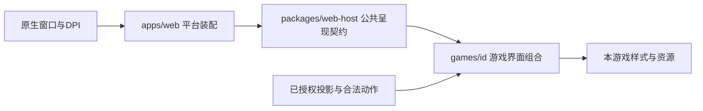

# 界面复用与渐进提炼

本页维护盒子与游戏界面的复用边界、统一组织方式及后续提炼顺序。2026-10-28形成方案，2026-10-29已实现共享纯测量、平台手机门禁及既有控件去重；各游戏验收进度见[全部游戏任务](../tasks/all-games-layout-rollout.md)。产品要求归[通用视觉](visual-design.md)、权限归[平台规格](phase-02-platform-spec.md)，实际目录与构建契约归[架构](architecture.md)。

当前平台支持手机竖屏、管理横屏和电脑玩家横屏；确认手机横向时显示顶层旋转提示。旧360×640／640×360试点结果只作历史证明，不能复制成共享最小尺寸或后续测试矩阵。

## 先复用什么，哪些仍是建议

| 层次／能力        | 当前事实与可立即采用的方式                                                              | 待提炼部分及边界                                                                                            |
| ----------------- | --------------------------------------------------------------------------------------- | ----------------------------------------------------------------------------------------------------------- |
| 窗口、工作区、DPI | 原生窗口提供内容区，现有显示控制负责Windows DPI与页面倍率                               | 默认最大化是原生打开策略，不是游戏布局／网页缩放策略；不在各游戏中重复最大化或按4K额外乘倍率                |
| 权限、命令、反馈  | `GameHost`／`GameClient`及现有slots已装配管理、保存／错误／重试、计时及游玩模式         | 复用现有 `SessionFeedback(mode="messages")`，不在游戏里按中文字符串过滤“已保存”；不再建第二份会话或命令总线 |
| 浮窗、规则、偏好  | `@tablemax/web-host`已有 `OverlayPanel`、`RulesGuide`、倒计时、声音／引导偏好及显示设置 | 优先复用既有关闭、焦点和滚动机制；游戏提供内容、章节、入口与样式，不复制宿主实现                            |
| 设备与玩家外框    | `PlayerFrame`已有iframe、电脑横竖偏好、历史同步和旧边界                                 | 平台统一确认手机分类与旋转门禁；不能把 `isDesktopPlayer=false` 当手机，因为它还含平板与未知设备             |
| 可用区域测量      | 共享`useViewportSnapshot`已供宝可梦、UNO及其余游戏消费；宝可梦本地hook仍解释布局 | 共享输出只含几何；不搬入H／P／L策略、牌阵列数或退役短屏门槛 |
| 布局与动作区域    | 游戏已有不同的操作、场地及辅助面板，能组合公共控件                                      | 可选提炼场景填充、有限内容区、状态／操作容器；牌阵排列、卡片规格和阶段分支不统一                            |
| 保存后动效        | 平台已有保存事件、消费／恢复约束，游戏已有真实DOM锚点                                   | 可提炼锚点测量与失效机制；动作到角色／牌位／音效的解释留在游戏，私看不得进入公共锚点                        |

“更多复用”首先是减少重复策略、状态和验证成本，不以删掉更多行数为目标。已有公开导出能解决的问题先直接接入；新能力先有真实使用场景，再进入共享入口。

## 统一组织与依赖方向

采用“平台装配＋小能力＋游戏组合”，继续使用现有包，不新建一个平行的UI包、中心游戏样式表或手工组件注册表。

图中箭头表示调用／输入方向，不允许共享层反向导入游戏。平台可在已有宿主服务和slots中注入能力，游戏不得读取完整RoomSession、凭证或Socket。设备类型、窗口形状和管理员权限是三个独立维度。

| 归属                       | 统一放什么                                                            | 不放什么                                               |
| -------------------------- | --------------------------------------------------------------------- | ------------------------------------------------------ |
| `apps/desktop/native/`     | 默认打开、最大化／全屏恢复、屏幕工作区、原生桥接                      | 游戏卡宽、地图避让、手机判断                           |
| `apps/web/`平台呈现装配    | 设备分类、PlayerFrame、手机门禁、顶层焦点隔离、原生／浏览器显示适配   | 按游戏ID选择棋盘排列，解释某张牌能力                   |
| `packages/web-host/src/`   | 展示契约、既有slots、偏好、可访问控件与已实现纯测量；锚点仍是候选 | 游戏类型分支、完整规则状态、强制手机比例               |
| `games/<id>/web/`及`ui/`   | 消费授权投影，判断阶段与合法动作，组合区域及主题                      | 原生窗口控制副本、全平台设备策略、复制其他游戏私有组件 |
| 现有`tools/test`及维护工具 | 公共机制检查、游戏夹具、真实截图、报告生成及精确清理                  | 第二套用例账本、未经来源核验的通用截图或假数据         |

共享包继续从现有 `src/index.tsx`／`platform.ts`导出；本轮纯测量已收至`viewport/`。`components/`、`preferences/`及平台`presentation/`仅为未来数量增加后的候选组织，本次不批量搬文件或更改旧导入路径。每项能力的唯一说明放在对应正文／代码导出附近，索引只导航，不另建易漂移的能力清单JSON。

## 建议提炼的小接口

纯测量与既有控件复用已落地；几何锚点仍是候选，不是可调用的共享导出。新增能力保持兼容旧宿主和已冻结发行，不升级SDK类型或保存格式。

### 纯测量快照

`@tablemax/web-host`已导出`useViewportSnapshot(rootSelector, safeAreaPrefix)`及其纯测量类型，实现在`packages/web-host/src/viewport/`。返回`viewport`、`safeInsets`、`available`、`orientation`与`revision`；全部尺寸都是当前文档CSS像素，不是显示器物理像素。游戏在自身根节点声明四侧`env(safe-area-inset-*)`变量并传入前缀。宝可梦和UNO已作为两类消费者验证；H／P／L、工作区上限和阶段区域仍由游戏决定。

订阅合并到一帧一次读取，监听resize、visualViewport与测量根／祖先相关样式变化，支持延迟挂载、根替换和卸载清理。不要监听整棵游戏DOM的所有属性后同步反复测量。测量值和用于测量的CSS输入分开，避免把初始0px写回安全区变量导致真实env值永远无法读取。

- 以当前文档／iframe的实际CSS尺寸为准，订阅resize及visualViewport变化，卸载时清理；父窗口已扣的工具栏／边距不能再扣一次。
- 不输出host／player权限、游戏阶段、最小支持尺寸、固定列数或强制H／P／L；这些由宿主明确上下文和游戏组合决定。
- 不根据缩放比例再次修改界面倍率，不写显示偏好，不发规则动作，也不改变组件key。键盘出现、旋转与决策变化不能互相冒充。
- 未测得根节点时先使用可用视口快照并在根节点建立后重新测量，不能永久缓存第一次的空节点或零安全区。

### 场景与区域容器

候选工作区只负责“全视口背景＋有限内容区”；内容最大宽高由调用者提供。状态、上下文、主场地、确认和辅助信息可以作为可选children／slots组合，公共容器不要求每款游戏拥有全部区域或同一DOM层次。

容器处理字号／热区下限、稳定占位和必要的单轴滚动边界；游戏决定每阶段出现什么、哪个区域是滚动负责人、是否允许棋盘缩放。普通取牌前后要稳定的区域应明确预留，不让空态、牌背或一条成功提示改变主场地位置。不要为统一布局迫使UNO手牌、九格牌阵、电力地图都变成同一种网格。

### 浮窗、反馈与设置组合

继续使用 `OverlayPanel`／`RulesGuide`及现有反馈slots。可在第二个消费者确有相同重复时提炼小型设置组合器，但参数应是已有控件与具名扩展内容，而非游戏枚举或包含所有设置的超大配置。计分、规则、历史等内容和菜单顺序继续由游戏负责。

普通浮窗的Escape／外侧关闭语义不能直接用于手机横屏门禁。菜单浮窗、非关闭式门禁与短结果提示是不同生命周期，不用一个 `kind` 组件包揽所有分支。

### 几何锚点与结果层

候选锚点机制以游戏提供的稳定ID绑定当前授权DOM，读取实际可见矩形；窗口变化、分支／决策切换、卸载时失效。阶段内可短暂保留刚保存动作的来源位置，旋转后不能沿用旧坐标。不可见或不存在的端点跳过，不复制DOM、隐藏卡面或秘密值来补齐动画。

游戏解释“从哪里到哪里”和主题，公共能力只处理几何、取消与减少动态。统一百分比坐标仍须说明所属容器；不能将手机、iframe和顶层窗口的坐标直接混用。

## 手机门禁属于平台的一次装配

此项已由`PlayerFrame`与`PhoneOrientationGuard`实现。顶层模态dialog覆盖整个iframe及其菜单／浮窗，底层iframe设为inert；不在每个游戏添加副本。盒子玩家页和游戏玩家页共用同一机制；管理窗口、电脑窄窗和触控电脑不触发。确认手机依据明确移动设备信号，方向以设备屏幕信号优先，避免软键盘缩短visualViewport高度时误判旋转。

手机分类与方向判断分开：先由平台结合明确移动设备信息确认手机，再根据当前可视区域决定是否覆盖。不能单凭宽高、触摸点数或“非电脑”判手机；平板／未知设备不擅自纳入手机专属阻断策略。保留已有电脑横竖偏好，方向变化不改持久配置。

门禁应阻止底层点击、拖动、键盘和焦点进入；无关闭入口，Escape不能绕过。恢复竖屏后只恢复仍有效的焦点／草稿，已被权威决策变化淘汰的选择不能复活；不暂停服务器计时或取消已发送命令。动画／减少动态、黑玻璃和提示文字统一维护，游戏主题可透出但不另绘秘密内容。

## 游戏保留的边界与反例

- 宝可梦原版六格与扩展九格、研究投票、缓冲强制换入、超梦私看及每个能力的确认语义由游戏解释。`BoardGrid`是宝可梦内部复用，不因两个玩法共用就升级为全平台牌桌组件。
- UNO手牌、选色、UNO抓漏及结果入口由UNO维护；可以消费相同测量、浮窗及反馈，不能消费宝可梦的合法目标判定。
- 电力公司的地图拓扑、镜头、城市锚点、PhonePages阶段切页及购买抽屉由电力公司维护；测量／锚点接口可共享，地图坐标系和避让策略不外移。
- 两个布局中外观相似的“确认”，可能分别意味着选位、直接投票或购买；公共按钮只展示给定动作与禁用状态，不能自己补确认步骤或推断合法性。

## 渐进采用顺序与验收

| 顺序             | 实施边界                                                       | 退出条件                                                                      |
| ---------------- | -------------------------------------------------------------- | ----------------------------------------------------------------------------- |
| 1 平台策略先闭合 | 实现确认手机分类和顶层横屏门禁；保留电脑外框偏好与旧契约       | 盒子、游戏、已打开浮窗均被覆盖；电脑不误触发；旋转不丢有效草稿                |
| 2 提炼纯能力     | 从宝可梦分离净区测量，去掉旧短屏门槛；两玩法适配为同一消费者族 | 数值口径一致、无规则依赖，旧入口仍能运行；没有因提炼改变牌阵或授权            |
| 3 第二类游戏验证 | 先用UNO复用测量／浮窗／反馈，必要时才提炼设置组合              | 真正减少重复，UNO独有动作、手牌和秘密仍正确；不同游戏可以拒绝不适合的区域容器 |
| 4 地图类按需接入 | 电力公司只接公共测量／锚点和已证明有用的容器                   | 地图可读、城市可点、手机页面与购买确认不受回归；不强制迁移地图算法            |

不能用一次大范围CSS替换作为上述步骤的捷径。先接入一个能力、一个游戏，再记录通过／失败和收益；没有实际第二类消费者前，不扩大为通用布局DSL。旧导出及旧ABI保留；新增公共导出须按网页宿主版本、共享运行时与独立构建机制同步验证，旧存档仍用原冻结发行，不改写历史模块或构建字节。

验证分两层：公共机制用少量确定场景验设备分类、净区、门禁、焦点及失效；每个受影响游戏只补其真实操作结构、最密状态和秘密路径，不重复所有尺寸。当前入口按H 1280×720、P 390×844、电脑L 1280×720组织；手机旋转为844×390仅验门禁与恢复，不新增手机横屏牌桌验收。其他游戏的内容下限由自身实测给出，不能照搬宝可梦卡宽或历史短屏数据。

报告绑定公共能力和游戏适配两侧的源码／参数SHA，记录外窗、iframe及净区；完整公共文件变化后，旧整文件指纹不匹配的证据不能直接宣称复用。点击要测实际按钮，滚动目标先滚至可见，详情必须展开后测边界。复用已有范围runner、失败预算、截图和HTML审阅工具；统一组织工具参数而不另建第二套账本。真实手机、Windows DPI、电视、服务持久化和安装器证明继续分层。

## 本次落地范围与后续入口

本次实际代码仅调整原生管理窗口默认打开／恢复策略，独立检查结果见[盒子窗口行为](box-visual-design.md#服务端窗口默认打开方式)。本页其余能力整理不创建共享实现、修改游戏或迁移验证器。既有源码事实、建议目录与未实施API已分别标明；未来实施时更新实际模块的说明与[接入指南](game-development.md)，不把此方案直接写成全平台已通过。

2026-10-29范围扩展为全部8款游戏、9个玩法，详见[逐游戏落地任务](../tasks/all-games-layout-rollout.md)。具体区域与参数由对应游戏页维护；公共控件去重、纯测量和门禁已实现，其他候选的状态与边界见[架构优化](architecture.md#面向本轮适配的架构优化计划)。不要把本轮源码证据提升为真实设备或安装器证明。
